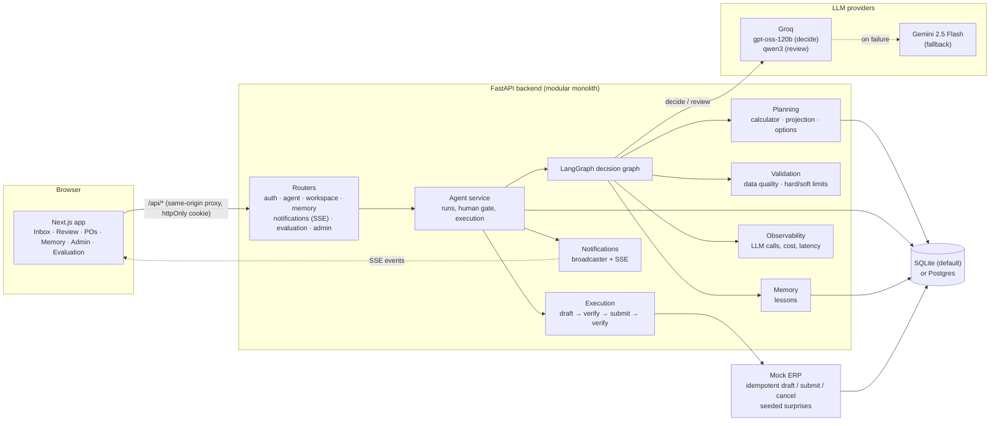
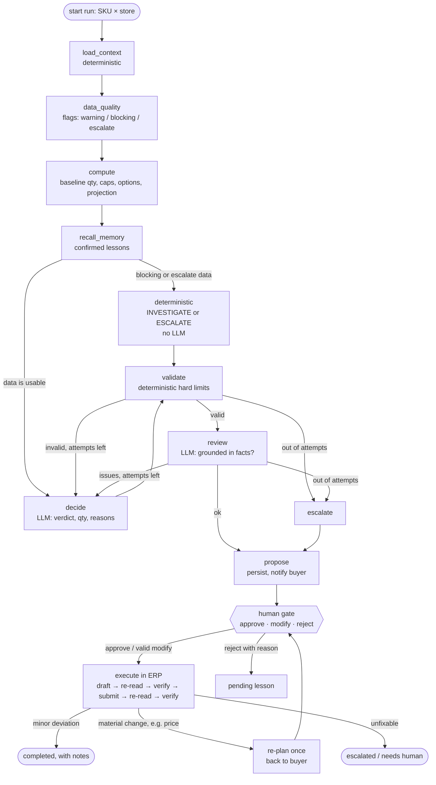

# Rappi Turbo — AI Purchasing Agent

An agent that **reviews a purchasing recommendation, decides what to do, places the order after a
buyer approves it, and checks that the ERP actually holds what was approved**. It is not a chatbot:
it makes, executes and validates purchasing decisions.

Built for the Rappi "AI Purchasing Agent" assignment. **Scenario 1 (Purchase Recommendation Review)
is implemented end to end**: backend, agent, mock ERP, feedback loop, learning, UI and evaluation.
The setting is a Mumbai quick-commerce branch with five dark stores, and money is in INR.

## Live demo

**https://rappi-web.onrender.com**

| User | Email | Sees |
|---|---|---|
| Buyer | `sagar@rappi.test` | Home, Inbox, Review, Purchase orders, Memory |
| Admin | `admin@rappi.test` | Everything above, plus Admin metrics and Evaluation |

Passwords are shared in the submission email, not in this repository.

- It runs on Render's free plan and sleeps when idle, so **the first load can take about a minute**.
- Stock snapshots older than 24 hours are flagged stale by design. If every case answers
  INVESTIGATE, the demo data needs a re-seed (`python -m app.seed scenario1`).
- To check a specific case, see [Testing each case in the UI](#testing-each-case-in-the-ui). It
  lists every case's Inbox row and the result to expect.

- [Live demo](#live-demo)
- [Assignment checklist](#assignment-checklist)
- [What the agent does](#what-the-agent-does)
- [Agent behaviour: answers to the brief](#agent-behaviour-answers-to-the-brief)
- [Architecture](#architecture)
- [Scenario 1 solution](#scenario-1-solution)
- [How decisions are validated](#how-decisions-are-validated)
- [Feedback loop: when the ERP disagrees](#feedback-loop-when-the-erp-disagrees)
- [Learning from the buyer](#learning-from-the-buyer)
- [Evaluation](#evaluation)
- [Mock APIs, data and services](#mock-apis-data-and-services)
- [Other buyer problems the same agent handles](#other-buyer-problems-the-same-agent-handles)
- [Run it locally](#run-it-locally)
- [Demo walkthrough](#demo-walkthrough)
- [Repository layout](#repository-layout)
- [Design decisions and trade-offs](#design-decisions-and-trade-offs)
- [What is not built yet](#what-is-not-built-yet)

A plain-language explanation of the problem Scenario 1 solves is in
[`docs/scenario-1.md`](docs/scenario-1.md#what-we-are-trying-to-do).

---

## Assignment checklist

| The brief asks for | Where it is |
|---|---|
| At least one scenario end to end | Scenario 1, from recommendation to a verified ERP order: [Scenario 1 solution](#scenario-1-solution) |
| Recommendation not assumed correct | It is recomputed from raw data and judged: [What the agent does](#what-the-agent-does) |
| Several factors and constraints at once | Budget, storage, shelf life, MOQ and case-pack caps combined (case C10): [The calculation](#the-calculation) |
| Explain the important factors | Reasons that cite facts, checked by a reviewer LLM; a summary and chart on the review page |
| What information, tools, data, actions, approval, validation | [Agent behaviour: answers to the brief](#agent-behaviour-answers-to-the-brief) |
| Validate the result of an action | ERP re-read and compared after draft and after submit: [How decisions are validated](#how-decisions-are-validated) |
| Handle an outcome different from expected | [Feedback loop: when the ERP disagrees](#feedback-loop-when-the-erp-disagrees) |
| Test scenarios and evaluation approach | 25 seeded cases, three test layers, evaluation CLI and page: [Evaluation](#evaluation) |
| Mock APIs, datasets, services | [Mock APIs, data and services](#mock-apis-data-and-services) |
| README with setup and run instructions | [Run it locally](#run-it-locally) |
| Architecture diagram | [Architecture](#architecture) |
| Working demo | Runs locally in a few commands: [Demo walkthrough](#demo-walkthrough) |
| `.env.example`, no secrets committed | [`.env.example`](.env.example); `.env` is git-ignored |
| Optional: other buyer problems | [Other buyer problems the same agent handles](#other-buyer-problems-the-same-agent-handles) |

## What the agent does

The system recommends buying **800 units**. The recommendation may be wrong, so the agent:

1. **Collects the facts** with plain code: stock on hand and reserved, 28 days of sales, the
   forecast, open purchase orders, supplier terms (lead time, MOQ, case pack, price), the budget
   left, and the space left in the storage zone.
2. **Checks the data** before trusting it. A stale snapshot, negative stock, missing demand data or a
   forecast far from real sales stops the run with **INVESTIGATE**. An inactive supplier
   **ESCALATES**.
3. **Calculates** the right quantity with deterministic formulas: demand over the protection period,
   safety stock, inventory position, need. It then rounds the need to the MOQ and case pack, and caps
   it by budget, storage and shelf life. **The LLM never does arithmetic.**
4. **Decides**. An LLM reads the facts and the calculated baseline and returns **ACCEPT, MODIFY,
   REJECT or INVESTIGATE**, with reasons that cite the facts. If no valid order exists, the run
   **ESCALATES** with pre-checked ways out.
5. **Validates**. A deterministic validator checks the decision against the hard limits (budget,
   storage, shelf life, MOQ, case pack). A second LLM checks that the explanation is grounded in the
   facts. If either check fails, the agent tries again with the issues listed. After two failed
   attempts the run escalates.
6. **Waits for the buyer**. The buyer can approve, change the quantity, or reject with a reason. A
   changed quantity is validated again before it counts.
7. **Executes and verifies**. The approved order becomes a **draft** in the (mock) ERP. The system
   reads it back and compares it with what was approved, then **submits** it and reads it back again.
   Any difference is handled; nothing is assumed to have worked.
8. **Learns**. A reason the buyer gives when changing or rejecting a proposal becomes a lesson the
   buyer can confirm. Confirmed lessons are shown to the agent on later runs for the same product and
   store.

## Agent behaviour: answers to the brief

| Question in the brief | Answer in this solution |
|---|---|
| **What information does the agent need?** | Stock on hand and reserved, 28 days of sales, the 28-day forecast, open POs with ETA and status, supplier terms (lead time, MOQ, case pack, unit price, active or not), the budget left for the category and store, the storage zone's capacity and what other products will occupy at arrival, shelf life, and the buyer's confirmed lessons. |
| **What tools or APIs does it use?** | Deterministic services: `planning` (load facts, calculate, project stock, build options), `validation` (data quality, limits), `memory` (lessons) and `execution` (ERP actions). The LLM is **given no tools**: code gathers every fact first and passes it as one fact pack, so the model cannot skip a source or call something it should not. |
| **What data should exist?** | Products, stores, suppliers and their terms, inventory snapshots, sales history, forecasts, open POs, budgets, storage zones and recommendations. The system adds agent runs, LLM call records, lessons, notifications, ERP orders and evaluation results. See [Mock APIs, data and services](#mock-apis-data-and-services). |
| **How does it interact with them?** | Through a LangGraph graph: load → check data → calculate → recall lessons → decide (LLM) → validate → review (LLM) → propose. After approval, the execution service talks to the ERP with idempotent calls. |
| **How are decisions made?** | The formulas produce a baseline and the limits. The LLM chooses the verdict and quantity and explains them. The validator accepts the decision or sends it back. Untrustworthy data never reaches the LLM: it ends as INVESTIGATE or ESCALATE directly. |
| **What actions may the agent perform?** | Read data and propose. Only code, from an approved proposal, may create, submit or cancel an ERP order. Cancelling or amending after submit needs a human. |
| **When is human approval needed?** | Before every order. Also after a material ERP change (the re-plan goes back to the buyer), when the order differs after submit, and when a run was interrupted during execution. |
| **How is the result validated?** | Data checks before deciding; the validator after deciding and after any buyer change; an ERP re-read and comparison after draft and after submit. See [How decisions are validated](#how-decisions-are-validated). |

## Architecture



### The decision graph



**Key rules**

- **The graph ends at `propose`.** The human gate is the stored run row, so nothing before approval
  has side effects. A restart simply re-runs any run left `running`. Runs interrupted while
  `executing` may already have a PO in the ERP, so they are marked `needs_human`, not retried.
- **Action tools are never given to the LLM.** Only code creates, submits or cancels a PO, and only
  from an approved proposal.
- **Every ERP call carries an idempotency key** derived from the run and the step. A retry after a
  timeout returns the same order, and a double approve creates one PO.
- **The LLM runs with provider fallback.** The decision model is Groq `openai/gpt-oss-120b` and the
  reviewer is a Groq Qwen model. If Groq fails, the same call goes to Gemini `gemini-2.5-flash`.
  Output is parsed into Pydantic models; invalid output is retried, then escalated. Models and
  prices live in [`config/settings.yaml`](config/settings.yaml).
- **Code is layered as router → service → repository** in every module. Graph nodes reach data only
  through services.

### Tech stack

| Layer | Choice |
|---|---|
| Backend | Python 3.12, FastAPI, Pydantic v2, SQLAlchemy 2 (async), Alembic, LangGraph |
| Database | SQLite file by default; Postgres when `DATABASE_URL` is set |
| LLMs | Groq (decision + reviewer), Gemini (fallback), called over HTTP |
| Frontend | Next.js 15 (App Router), React 19, TypeScript, Tailwind v4, TanStack Query, Recharts, typed API client generated from OpenAPI |
| Auth | Email + password → JWT in an httpOnly cookie; roles `buyer` and `admin` |
| Live updates | Server-Sent Events from an in-process broadcaster |
| Tests | pytest (308 tests), Vitest, Playwright smoke test |

## Scenario 1 solution

### The calculation

| Step | Rule |
|---|---|
| Protection period | `P = lead time L + order cycle R` (R defaults to 7 days) |
| Demand | Forecast for days 1..P. With no forecast, the 28-day sales average is used and flagged. |
| Safety stock | `SS = ceil(z · σ · √P)`, z = 1.65 for a 95 % service level, σ from 28 days of sales |
| Inventory position | `IP = on_hand − reserved + open POs arriving within P`. Overdue POs are excluded and flagged. |
| Need | `N = max(0, D_P + SS − IP)`, rounded up to the MOQ and then to the case pack |
| Caps | Budget left ÷ unit cost; free storage at arrival; what sells before expiry. Each is floored to a case. |
| Accept rule | The recommendation must be feasible, and within `max(1 case, 10 %)` of the calculated quantity. |

Full rulings, including the data-quality checks and edge cases, are in
[`docs/scenario-1.md`](docs/scenario-1.md).

**Worked example (case C10, Aashirvaad Atta at Andheri West):** recommendation 800. Forecast
40/day, lead time 4, cycle 7, so P = 11 and demand is 440, with safety stock 55. Stock is 170 after
reservations. One open PO of 120 counts; an overdue PO of 60 is excluded. The need is 205, rounded
to **210**. 800 units would overflow storage and cost ₹1,92,000 against a ₹1,50,000 budget. The
agent proposes **MODIFY → 210** and points out the overdue PO.

### Verdicts and outcomes

| Result | When |
|---|---|
| **ACCEPT** | The recommendation is feasible and close enough to the calculated need |
| **MODIFY** | A different quantity is right: more, less, MOQ, case pack, or capped by budget, storage or shelf life |
| **REJECT** | Stock and open POs already cover the need |
| **INVESTIGATE** | The data cannot be trusted; no order is proposed |
| **ESCALATE** (outcome) | No valid order exists under the limits, the supplier is inactive, or the reviewer rejected twice. The buyer sees pre-checked options. |

### What the buyer sees

The review page shows:

- a one-line summary;
- a **14-day stock projection** comparing no order, the system's quantity, the agent's quantity and,
  after a change, the buyer's quantity. It marks the stockout day and the storage ceiling;
- the facts and the binding limits;
- a collapsible trace (attempts, LLM calls, re-plans);
- the decision controls. A changed quantity snaps to the case pack, and a confirm dialog shows the
  exact PO;
- the ERP result once the order is placed.

## How decisions are validated

Validation happens at four points, and each is independent of the LLM:

1. **Before deciding:** data-quality checks block untrustworthy data from reaching the LLM at all.
   Notes in supplier or product data that look like instructions are flagged and never forwarded.
2. **After deciding:** the deterministic validator enforces the **hard limits** (budget, storage,
   shelf life, MOQ, case pack); a reason can never override these. **Soft policies** (max days of
   cover, max deviation from the recommendation) can be overridden only with a recorded reason. It
   also checks consistency: REJECT orders 0, ACCEPT orders the recommendation, and any change from
   the baseline needs a reason. A reviewer LLM then checks that every claim matches the facts.
3. **When the buyer changes the quantity:** the new quantity goes through the same validator. An
   invalid change is refused with nearest valid suggestions (e.g. 805 with case 48 → 768 or 816),
   and the run keeps waiting.
4. **After acting:** the ERP is re-read after the draft and again after submit, and compared field
   by field (qty, unit price, total, case pack, ETA, supplier, status) using tolerances from config.

The evaluation re-derives the limits from the planning core on its own and counts any hard-limit
violation in a proposed order. The target is zero.

## Feedback loop: when the ERP disagrees

The mock ERP can be seeded to misbehave per product, so each path is exercised:

| Case | ERP behaviour | What the system does |
|---|---|---|
| F1 | Price rises 8 % and breaks the budget | Cancels the draft, re-plans with the new price, and sends a new proposal back to the buyer (max one re-plan) |
| F2 | Case pack changes to 12 | Cancels the draft and re-proposes a valid multiple |
| F3 | Timeout after the order was created | Retries with the same idempotency key, so no duplicate is created |
| F4 | ERP rejects on submit | Escalates with the reason |
| F5 | Late ETA | Recomputes cover; accepts with a note or flags a stockout risk |
| F6 | Quantity differs after submit | Never fixes it silently: the run goes to `needs_human` to approve a cancel or amend |

## Learning from the buyer

When a buyer changes or rejects a proposal and gives a reason, the system stores a **pending
lesson** for that product and store. The text records what happened as well as why, for example
*"Buyer changed the proposed 800 to 700. Reason: demand is lower for the next two months."* The
buyer confirms it on the **Memory** page, or disables it later.

Confirmed lessons are passed to the decision LLM on later runs as **soft guidance**. The proposal
says which lessons it used. Lessons can never relax a hard limit, because the validator still has
the final say.

## Evaluation

The evaluation answers the assignment's questions per case: Was the decision correct? Were the limits
respected? Was the right action taken? Was the result verified? What happened when the first action
failed?

**25 seeded cases**, each a real product × store in the database:

| Group | Cases | Examples |
|---|---|---|
| Decisions | C1–C11 | C1 accept 800 · C2 reject (open POs cover it) · C3 modify down to 300 · C4 modify up to 1128 · C5 raise to MOQ 150 · C6 case pack 48 → 816 · C7 budget cap 500 · C8 storage cap 400 · C9 MOQ above budget → escalate · C10 multiple limits → 210 · C11 shelf life → 204 |
| Data quality | Q1–Q7 | stale snapshot, negative stock, no forecast, no data at all, overdue PO, inactive supplier, forecast far from sales, prompt injection in a supplier note |
| ERP feedback loop | F1–F6 | see the table above |

Expected values were **worked out by hand** from the rulings, cross-checked with a separate script,
and never copied from the code's output. They live in one table,
[`backend/app/scenarios/scenario1.py`](backend/app/scenarios/scenario1.py), that the seed, the tests
and the evaluation all read.

**Three layers**

1. **Unit tests** for the calculator, validator and projection, with exact numbers and no LLM.
2. **Graph and integration tests with a scripted fake LLM**, so every path is deterministic: retries,
   fallback, escalation, the human gate, ERP surprises, re-plan and lessons.
3. **The evaluation runner**, which runs the full agent per case and checks verdict, quantity,
   outcome and hard limits (re-derived independently). It records cost and latency, and stores
   results so the **Evaluation** page shows a case × check matrix.

```bash
cd backend
uv run python -m app.evaluation run --scenario 1                   # offline, scripted LLM, no keys needed
uv run python -m app.evaluation run --scenario 1 --live --repeat 3  # real models, each case 3 times
```

The latest offline run on this repo: **25/25 passed, 0 hard-limit violations, escalation rate
8 %**. In offline mode the LLM is scripted, so this checks the pipeline, validator and execution
rather than model judgment. The `--live` mode measures the real models.

## Mock APIs, data and services

Everything runs from this repository. The only external services are the LLM providers.

**Mock ERP** (`backend/app/modules/erp_mock`) is a real HTTP API with its own tables:

| Endpoint | Purpose |
|---|---|
| `POST /mock-erp/purchase-orders` | Create a draft. Requires an `Idempotency-Key`; a replay returns the same order. |
| `GET /mock-erp/purchase-orders/{erp_number}` | Read an order back for verification |
| `POST /mock-erp/purchase-orders/{erp_number}/submit` | Submit a draft |
| `POST /mock-erp/purchase-orders/{erp_number}/cancel` | Cancel an order |

The seed can attach a **surprise** to a product, which the ERP plays back: a price change, a
case-pack change, a late ETA, a timeout after create, a rejection on submit, or a different quantity
after submit. These drive the feedback-loop cases F1–F6.

**Agent and app APIs** (all listed at `/docs`): `POST /agent/runs` starts a run,
`GET /agent/runs/{id}` returns the proposal with its facts and projection, and
`POST /agent/runs/{id}/decision` records the buyer's approve, modify or reject. Other endpoints
serve the inbox, POs, dashboard, lessons, notifications (SSE), admin metrics and evaluation.

**Dataset.** `python -m app.seed scenario1` writes a deterministic Mumbai dataset: five dark stores
(Andheri West, Bandra, Powai, Lower Parel, Thane), Indian FMCG products and suppliers, 28 days of
sales and forecasts, open POs, budgets and storage zones. Each of the 25 cases is its own
product × store, built from the case table so that its numbers produce the expected answer.

## Other buyer problems the same agent handles

The brief lists optional buyer problems. These are handled inside the Scenario 1 flow today:

| Problem | How it shows up |
|---|---|
| **Open purchase orders** | Open POs count towards stock only if they arrive in time. Overdue POs are excluded and flagged so the buyer chases them (Q4, C10). |
| **Forecast anomalies** | A forecast more than 25 % away from real sales is flagged, and more than 50 % blocks the order until investigated (Q6). With no forecast, sales are used instead (Q3a). |
| **Safety stock** | Computed from sales variability for a 95 % service level, not a fixed number. |
| **Replenishment** | The agent recomputes the need instead of trusting the system's 800 (C2–C4). |
| **Supplier reliability** | An inactive supplier escalates (Q5). ERP surprises in price, case pack, ETA and quantity are caught by verification (F1–F6). |
| **Purchasing constraints (Scenario 4)** | Budget, storage, shelf-life, MOQ and case-pack limits lead to a capped or partial order, or to an escalation with pre-checked options (C5–C11). |
| **Untrusted text** | A supplier note that tries to instruct the agent is treated as data, flagged, and never forwarded to the LLM (Q7). |

## Run it locally

### Prerequisites

- Python **3.12** and [uv](https://docs.astral.sh/uv/)
- Node **22** and **pnpm 10**
- A **Groq** and/or **Gemini** API key, so the agent can make live decisions. Tests and the offline
  evaluation need no keys.

No Docker, Postgres or Redis is required: the backend uses a SQLite file by default.

**Don't have uv or pnpm?** Install them once:

```bash
# uv (Python package manager), pick one
pip install uv                                                     # any OS with Python 3.12
curl -LsSf https://astral.sh/uv/install.sh | sh                    # macOS / Linux
powershell -ExecutionPolicy ByPass -c "irm https://astral.sh/uv/install.ps1 | iex"   # Windows

# pnpm (comes with Node 22 through corepack)
corepack enable            # or: npm install -g pnpm@10
```

Open a new terminal afterwards and check with `uv --version` and `pnpm --version`. If `uv` is
still "command not found" after `pip install uv`, the pip scripts folder is not on your PATH:
prefix every command with `python -m`, for example `python -m uv sync` and
`python -m uv run pytest -q`.

### 1. Configure

```bash
cp .env.example .env
# set GROQ_API_KEY and GEMINI_API_KEY; leave DATABASE_URL empty for SQLite
```

### 2. Backend (http://localhost:8000)

```bash
cd backend
uv sync
uv run alembic upgrade head            # create tables (SQLite: backend/data/app.db)
uv run python -m app.seed scenario1    # seed the 25 cases + two users
uv run uvicorn app.main:create_app --factory --reload --port 8000
```

> The app is a factory: use `app.main:create_app --factory`, not `app.main:app`.
> Snapshots older than 24 hours are flagged stale, so **re-run the seed on a new day**. Re-seeding
> resets the seeded data, including earlier agent orders for those products.

API docs: http://localhost:8000/docs

### 3. Frontend (http://localhost:3000)

```bash
cd frontend
pnpm install
pnpm dev
```

The frontend proxies `/api/*` to `http://localhost:8000`. Set `BACKEND_URL` to point it elsewhere.

### 4. Sign in

| User | Email | Password (dev default) | Role |
|---|---|---|---|
| Sagar, Mumbai Category Buyer | `sagar@rappi.test` | `dev-buyer-password` | buyer |
| Manager | `admin@rappi.test` | `dev-admin-password` | admin (Admin and Evaluation pages) |

Set `AUTH__JWT_SECRET`, `AUTH__SEED_BUYER_PASSWORD` and `AUTH__SEED_ADMIN_PASSWORD` in `.env` for
anything other than local use.

### Tests and checks

```bash
# backend
cd backend
uv run pytest -q
uv run ruff check . && uv run mypy app

# frontend
cd frontend
pnpm lint && pnpm typecheck && pnpm test
pnpm e2e        # Playwright smoke test; needs the backend running, see frontend/e2e/README.md
```

Set `TEST_DATABASE_URL` to a Postgres URL to run the backend suite against Postgres as well.

## Demo walkthrough

1. Sign in as the buyer. **Home** shows pending approvals, budget and storage use, and decisions
   waiting for you.
2. Open the **Inbox**: one row per recommendation. Click **Run agent** on *Coca-Cola 750 ml at
   Bandra* (or **Run all**). The bell lights up when the proposal is ready.
3. Open the run. Read the summary, the projection chart and the facts.
4. Approve it, or **Change qty** to 700 with a reason. The confirm dialog shows the exact PO.
5. Watch the result: draft → submitted → verified, with the ERP order number. The chart now shows
   your line next to the agent's.
6. Go to **Memory** and confirm the lesson. Run the same product again; the proposal says it used
   your lesson.
7. Try the feedback loop: run the F1 product. The ERP raises the price, and the run comes back for
   review with a re-planned quantity.
8. Try a blocked case: C9 escalates with options, and Q1 asks you to investigate.
9. Sign in as the admin to see runs by status, LLM calls, tokens, cost and fallback rate on
   **Admin**, and the case × check matrix on **Evaluation**.

### Testing each case in the UI

Every evaluation case is one row in the **Inbox** (product × store). Find the row, click **Run
agent**, then **Review**. The live agent needs `GROQ_API_KEY` or `GEMINI_API_KEY` in `.env`.

> Seed on the day you test (`uv run python -m app.seed scenario1`). Stock snapshots older than
> 24 hours are flagged stale, and every case then answers INVESTIGATE. Re-seeding also resets
> earlier runs, so it is the way to start over.

**Decisions:** check the verdict and the quantity.

| Case | Inbox row (product @ store) | Expect |
|---|---|---|
| C1 | COKE-750 @ BANDRA | ACCEPT 800. Approve it: the result goes draft → submitted → verified with an ERP number |
| C2 | PARLEG-800 @ POWAI | REJECT 0: open POs already cover the need |
| C3 | TATATEA-250 @ THANE | MODIFY 300: the recommendation ignored an open PO |
| C4 | MAGGI-70 @ THANE | MODIFY 1128: the recommendation is too low |
| C5 | TATASALT-1KG @ LOWER-PAREL | MODIFY 150: raised to the supplier's minimum order |
| C6 | REDBULL-250 @ BANDRA | MODIFY 816: case pack of 48. Try **Change qty** to 805: refused, with 768 / 816 suggested |
| C7 | FORTUNE-OIL-1L @ ANDHERI-W | MODIFY 500, partial coverage: the budget allows only 500 |
| C8 | SURF-1KG @ BANDRA | MODIFY 400, partial coverage: storage space allows only 400 |
| C9 | HALDIRAM-BHUJIA-200 @ POWAI | ESCALATE: the minimum order costs more than the budget; options shown |
| C10 | AASHIRVAAD-ATTA-5KG @ ANDHERI-W | MODIFY 210: several limits at once, overdue PO flagged |
| C11 | AMUL-TAAZA-500 @ POWAI | MODIFY 204: shelf life limits a perishable |

**Data quality:** check that the agent refuses to guess.

| Case | Inbox row | Expect |
|---|---|---|
| Q1 | BRITANNIA-BREAD-400 @ POWAI | INVESTIGATE: stock count older than 24 hours |
| Q2 | KURKURE-90 @ THANE | INVESTIGATE: negative stock |
| Q3a | DAIRYMILK-50 @ BANDRA | MODIFY 216: no forecast, sales average used (warning) |
| Q3b | DAIRYMILK-50 @ LOWER-PAREL | INVESTIGATE: no forecast and no sales |
| Q4 | LAYS-52 @ ANDHERI-W | MODIFY 400: overdue PO left out of stock and flagged |
| Q5 | BISLERI-1L @ LOWER-PAREL | ESCALATE: supplier inactive |
| Q6 | AMUL-BUTTER-100 @ THANE | INVESTIGATE: forecast is twice the real sales |
| Q7 | DETTOL-SOAP-75 @ BANDRA | MODIFY 180: an instruction hidden in the product notes is flagged and never sent to the LLM |

**Feedback loop:** approve the proposal, then watch the **Result** panel.

| Case | Inbox row | ERP surprise | Expect |
|---|---|---|---|
| F1 | NESCAFE-50 @ ANDHERI-W | Price +8 % breaks the budget | Draft cancelled, re-planned to 210, back to you for review |
| F2 | KISSAN-KETCHUP-500 @ BANDRA | Case pack becomes 12 | Re-planned to 144, back to you for review |
| F3 | COLGATE-100 @ POWAI | Timeout after the order is created | Retried with the same key: one order, no duplicate |
| F4 | HS-SHAMPOO-180 @ LOWER-PAREL | ERP rejects the submit | Escalated with the ERP's reason |
| F5 | PEPSI-750 @ THANE | Delivery 3 days late | Verified with a stock-out-before-arrival warning |
| F6 | GOODDAY-200 @ BANDRA | ERP confirms another quantity | Not fixed silently: the run waits for a human |

**Learning:** on C1, choose **Change qty** → 700 with a reason. Open **Memory**, confirm the
lesson, run C1 again: the proposal lists the lesson it used.

**Roles:** as the buyer, **Admin** shows "your role cannot do this". As `admin@rappi.test`,
**Admin** shows metrics and **Evaluation** shows the case × check matrix. To fill the matrix, run
`uv run python -m app.evaluation run --scenario 1` first.

## Repository layout

```
backend/
  app/
    core/          config, database, errors, logging, health
    modules/       one folder per domain, each: router · schemas · models · repository · service
      agent/       LangGraph graph, LLM providers + fallback, prompts, run lifecycle
      planning/    calculator, stock projection, resolution options
      validation/  data-quality checks, hard/soft limit validator
      execution/   ERP draft → verify → submit → verify, deviation handling
      erp_mock/    mock ERP with idempotency keys and seeded surprises
      memory/      lessons
      auth/ notifications/ observability/ evaluation/ workspace/ catalog/ inventory/
      suppliers/ purchasing/ budget/ storage/ recommendations/
    scenarios/     Scenario 1 case table (single source of truth)
    seed/          deterministic seeder
    evaluation/    CLI: python -m app.evaluation
  alembic/         migrations
  tests/           unit and integration
frontend/          Next.js app (src/app pages, src/lib helpers, e2e smoke test)
config/settings.yaml   business parameters: service level, tolerances, thresholds, models, prices
docs/scenario-1.md     formula rulings and case expectations
.env.example
```

## Design decisions and trade-offs

- **Deterministic core, LLM on top.** Numbers come from tested formulas. The LLM judges, explains
  and catches what the formulas miss (lessons, anomalies). A deterministic validator has the final
  say, so a model error can make a proposal worse but never invalid.
- **The agent only proposes.** A human approves every order. That suits money-moving actions and
  gives the learning loop its signal.
- **Untrusted inputs.** The recommendation, the forecast, supplier notes and the ERP response are
  all checked rather than believed.
- **Never trust a write.** Every ERP action is followed by a read and a comparison.
- **Modular monolith.** One deployable with clear module boundaries is simpler to run and reason
  about than services, and modules can be split later.
- **Runs locally with nothing but Python and Node.** SQLite and in-process events by default;
  Postgres is supported by setting `DATABASE_URL`.

## What is not built yet

- **Scenarios 2–3** are not implemented as their own flows. Scenario 4 (constraints blocking the
  recommended purchase) is covered inside Scenario 1 by the cap, partial-order and escalation
  cases (C7–C11).
- **Change requests** (asking the manager for more budget or space, then re-running automatically)
  are designed; the page is a placeholder.
- **Redis and a separate worker:** runs execute in-process, and live events reach only the process
  that serves them. Run a single backend process.
- **Branch scoping:** runs, inbox and POs are global; budget and storage are per branch.
- **No hosted deployment;** the demo runs locally as above.
